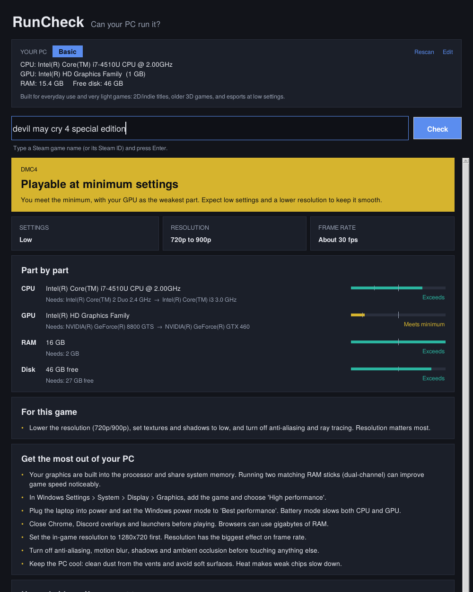
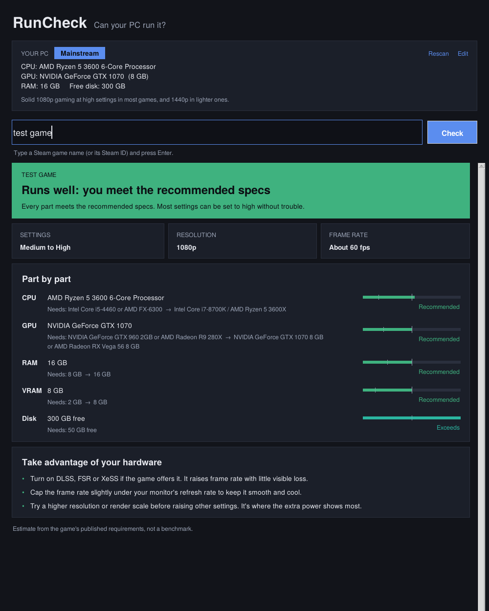
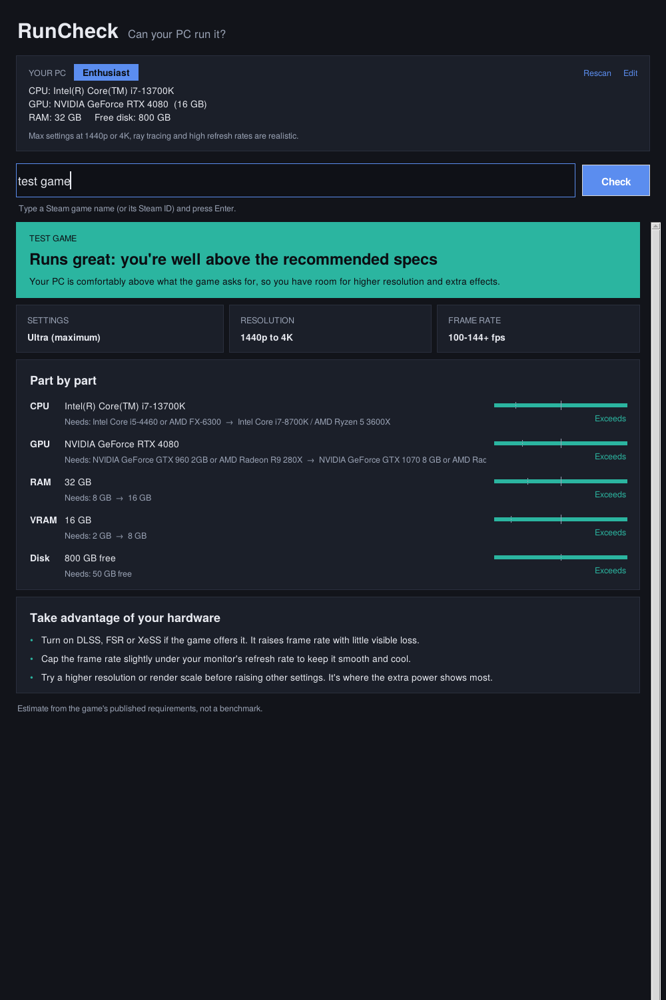

# RunCheck

**Can your PC run it?** Type a Steam game's name and RunCheck checks it against your hardware, then tells you
what to expect (settings, resolution, frame rate), which part is holding you back, and what to do about it.
It is written to be useful on every kind of PC, including older laptops, not just gaming rigs.

| Older laptop | Mid-range desktop | High-end |
|---|---|---|
|  |  |  |

## Run it

**Windows exe:** download `RunCheck.exe` from Releases and double-click it. Nothing to install.

**From source** (Python 3.10+):
```
pip install -r requirements.txt
python -m runcheck            # opens the window
python -m runcheck specs      # command line: show detected hardware
python -m runcheck check "Elden Ring"
```

## What you get
- Automatic hardware detection (CPU, GPU, VRAM, RAM, free disk), with an **Edit** button to fix a wrong value
  or check a friend's PC instead.
- A PC profile (Basic, Entry, Budget gaming, Mainstream, High-end, Enthusiast) with what that class of PC handles well.
- A verdict, expected settings, resolution and frame rate, and a part-by-part breakdown with bars.
- Advice that depends on the PC: low-spec tricks and upgrade ideas for weak machines, DLSS/resolution tips for strong ones,
  and a "free up disk space first" message when the PC itself is fine.
- Game search suggestions as you type, and offline use for games you've checked before (cached in `~/.runcheck/cache`).

## How it decides
CPUs and GPUs are compared with the hand-made score tables in `runcheck/data/` (GTX 1060 6GB = 100 for GPUs,
i5-4460 = 100 for CPUs). Your part reaches "borderline" at 85% of the game's minimum, "minimum" at 100%, and
"recommended" at 100% of the recommended spec. The verdict is your weakest part. RAM is compared by installed size
(a "16 GB" PC reports about 15.4 GB usable). If your CPU or GPU can't be matched, RunCheck says so instead of guessing.

These are **estimates from published requirements, not benchmarks.**

## Improve it
Missing hardware? Add a row to `gpus.csv` or `cpus.csv`. Then run `python -m pytest tests`.

## Build the exe
On Windows: `build_exe.bat`. Or push a tag like `v0.2.0` and the GitHub Action builds `RunCheck.exe` and attaches it
to the release.
